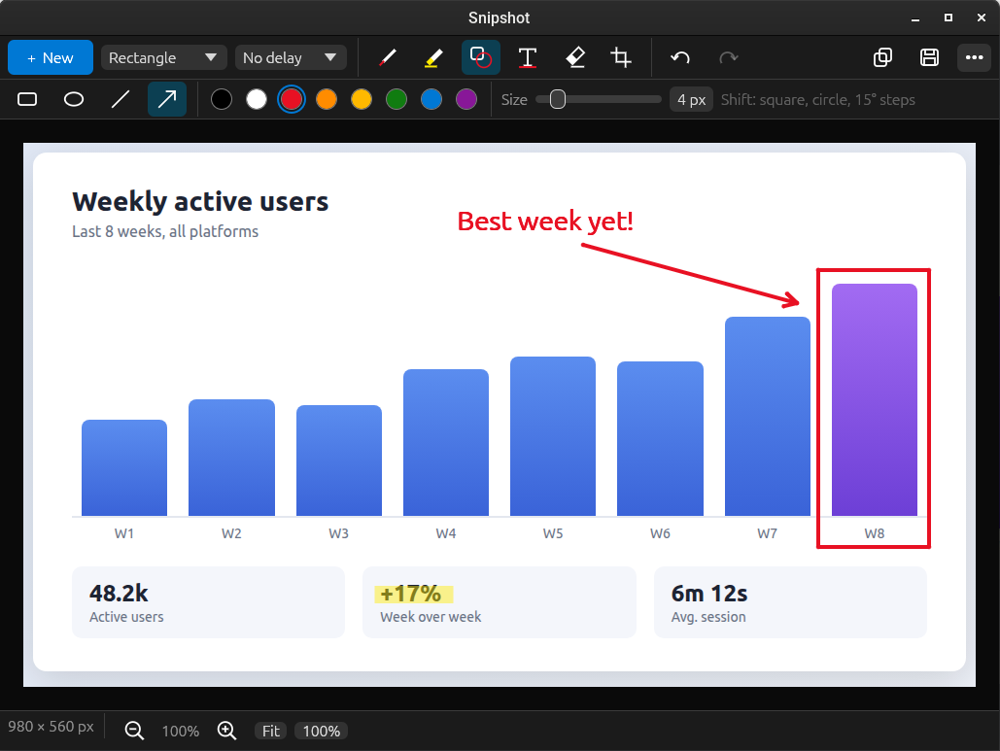

<p align="center">
  
</p>

<h1 align="center">Snipshot</h1>

<p align="center">
  A snipping tool for Linux, modeled on the Windows Snipping Tool, written in Rust with <a href="https://github.com/emilk/egui">egui</a>.
</p>



## Features

- **Snip modes:** rectangle, window, full screen, freeform
- **Delay:** none, 3, 5 or 10 seconds
- **Markup:** ballpoint pen and highlighter (with color palette and size), shapes (rectangle, oval, line, arrow; hold Shift for squares, circles and 15° angles), text labels (click to type, click to edit, drag to move), eraser, image crop, undo/redo, zoom
- **Look:** large, easy-to-read controls, and a Light, Dark or System theme (in the `•••` menu)
- **Output:** copies the snip to the clipboard and saves it to `~/Pictures/Screenshots` automatically (both can be turned off in the `•••` menu). Ctrl+S saves as PNG or JPEG.

## Build and run

```bash
cargo build --release
./target/release/snipshot
```

Start a snip straight away, for example from a keyboard shortcut:

```bash
snipshot --rect            # or --window, --fullscreen, --freeform
snipshot --rect --delay 3
```

On Cinnamon, open **Keyboard → Shortcuts → Custom Shortcuts** and bind e.g. `Shift+Super+S` to `snipshot --rect`.

## Install

Download a package from the [latest release](https://github.com/thuutien/snipshot/releases/latest). The prebuilt packages are for x86_64.

**Debian, Ubuntu, Linux Mint** (`.deb`, needs Ubuntu 24.04+, Mint 22+ or Debian 13):

```bash
sudo apt install ./snipshot_*_amd64.deb
```

**Any distro with Flatpak** (`.flatpak`; the Freedesktop runtime is fetched from Flathub if needed):

```bash
flatpak install --user ./snipshot-*-x86_64.flatpak
```

**Tarball** (`.tar.gz`, needs glibc 2.39+). It installs to `~/.local/bin`, plus the app icon and an app-menu entry:

```bash
tar xzf snipshot-*-x86_64-linux.tar.gz
cd snipshot-*-x86_64-linux
packaging/install.sh
```

**From source:**

```bash
cargo build --release
packaging/install.sh
```

`SHA256SUMS` in each release lists the checksums of the files. To build all three packages yourself, run `packaging/build-packages.sh` (needs `dpkg-deb`, `flatpak` and the `org.freedesktop.Platform//25.08` runtime).

## Updates

Snipshot checks GitHub releases of the repository in `Cargo.toml` (`repository = ...`) at most once a day, and shows a banner when a newer version is published. Turn it off, or check by hand, in the `•••` menu.

Click **Update now** to download and install the update without leaving the app, then **Restart now** to switch to it. The download is checked against the release's `SHA256SUMS` before anything is installed. How it installs depends on how you installed Snipshot:

| Installed from | How the update is installed |
|---|---|
| Tarball (`install.sh`) | The `snipshot` program is replaced in place |
| `.deb` | `apt-get` through `pkexec`, which asks for your password |
| Flatpak | `flatpak install` on the host (this is why the Flatpak has permission to talk to Flatpak) |

A copy built from source isn't updated by the app; use `git pull` and `cargo build` instead.

To publish an update, bump `version` in `Cargo.toml`, run `packaging/build-packages.sh`, and create a GitHub release tagged like `v0.2.0` with the files from `dist/`, including `SHA256SUMS`.

## Keyboard shortcuts

| Keys | Action |
|---|---|
| Ctrl+N | New snip |
| Esc | Cancel snip / cancel crop |
| Enter | Apply crop |
| Ctrl+Z / Ctrl+Y | Undo / redo |
| Ctrl+C | Copy |
| Ctrl+S | Save as |
| Ctrl + / Ctrl − / Ctrl+0 | Zoom in / out / fit |

## Platform notes

- **X11:** the screen is captured directly, and window snips use the window manager's window list.
- **Wayland:** the screen is captured through the xdg-desktop-portal Screenshot API. Wayland doesn't let apps see where other windows are, so window snips act like rectangle snips there.
- The overlay covers the monitor under the mouse pointer. Full-screen snips capture every monitor.
- On X11 the clipboard contents belong to the running app. If you close Snipshot without a clipboard manager running, the copied snip is gone.

## Code layout

| File | Purpose |
|---|---|
| `src/main.rs` | Command-line flags, window setup |
| `src/app.rs` | Main window, screen switching, copy/save |
| `src/capture.rs` | X11 and Wayland screen capture, window list |
| `src/overlay.rs` | Full-screen snip overlay and the snip modes |
| `src/editor.rs` | Markup editor: tools, crop, undo, zoom |
| `src/raster.rs` | Burns ink strokes into the saved image |
| `src/text.rs` | Text labels: on-screen drawing and burning into the image |
| `src/updater.rs` | Checks GitHub for a newer release, then downloads, verifies and installs it |
| `src/icons.rs` | Toolbar icons drawn in code |
| `src/style.rs` | Text and control sizes, light/dark theme |
| `src/settings.rs` | Settings in `~/.config/snipshot/settings.conf` |
| `assets/` | App icon (SVG source and 256 px PNG) |
| `packaging/` | Desktop entry, AppStream metadata, install script, package builder |
| `docs/` | README screenshot |
